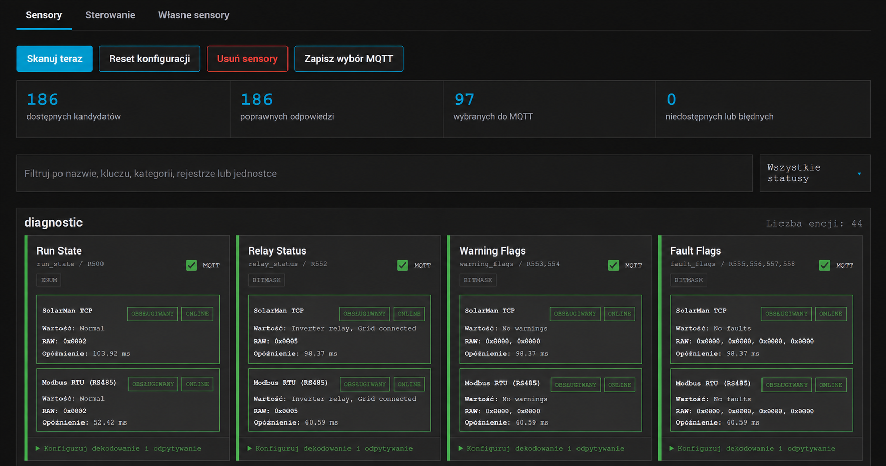

# SolarMan Diagnostics 2.0.7

[](https://github.com/Wilk33/deye-solarman-ha-addon/actions/workflows/validate.yml)

SolarMan Diagnostics łączy lokalną diagnostykę falownika Deye, porównanie dwóch transportów i bezpieczne encje MQTT w jednym dodatku Home Assistant OS.
## Dodatki w repozytorium

Repozytorium udostępnia trzy niezależne dodatki Home Assistant OS:

- `SolarMan Diagnostics` 2.0.7 - diagnostyka i sterowanie falownikiem Deye;
- `Alarm` 1.0.2 - monitorowanie encji oraz wyjście audio albo GPIO Raspberry Pi 5;
- `Continuous Noise` 1.0.0 - ciągłe odtwarzanie wybranego szumu z przełącznikami MQTT.

Dokumentacja nowych dodatków:

- [Alarm](haos-alarm/DOCS.md)
- [Continuous Noise](continuous-noise/DOCS.md)

SolarMan Diagnostics combines local Deye inverter diagnostics, dual-transport comparison, and controlled MQTT entities in one Home Assistant OS add-on.

- [Strona projektu / Project site](https://wilk33.github.io/deye-solarman-ha-addon/)
- [Definicje rejestrów / Register reference](https://wilk33.github.io/deye-solarman-ha-addon/reference/)

## Trzy filary / Three pillars

- Dwa transporty / Two transports - SolarMan TCP i bezpośredni Modbus RTU przez RS485.
- Niezależne katalogi / Independent catalogs - telemetria i sterowanie mogą pochodzić z różnych źródeł.
- Jedno MQTT / One MQTT - wspólne urządzenie, identyfikatory i tematy encji w Home Assistant.



`SolarMan Diagnostics` jest jednym instalowalnym dodatkiem Home Assistant OS do lokalnej komunikacji z falownikiem Deye. Jeden proces może jednocześnie obsługiwać dwa transporty:

- SolarMan TCP przez logger w sieci LAN;
- Modbus RTU przez bezpośredni adapter USB-RS485.

Dodatek używa jednego połączenia MQTT, jednego urządzenia Home Assistant i wspólnych identyfikatorów encji. Każda encja ma dokładnie jeden wybrany transport. Odczyt i zapis nie przełączają się samoczynnie na drugi transport.

## Tryby pracy

| Tryb | `solarman.enabled` | `rs485.enabled` | Zastosowanie |
| --- | --- | --- | --- |
| `solarman-only` | `true` | `false` | Odczyt i sterowanie przez lokalny logger SolarMan TCP. |
| `rs485-only` | `false` | `true` | Bezpośredni odczyt i sterowanie Modbus RTU. |
| `dual` | `true` | `true` | Oba transporty działają równocześnie, a transport jest wybierany osobno dla każdej encji. |

Co najmniej jeden transport musi być włączony. W trybie `dual` każdy transport ma niezależny worker, klienta, blokadę, interwały i ponowne łączenie. Awaria jednego transportu nie zatrzymuje odczytów drugiego.

## Najważniejsze funkcje

- sekwencyjny skan SolarMan TCP, a następnie RS485;
- niezależne monitorowanie i interwały obu transportów;
- panel Ingress z zakładkami `Sensory`, `Sterowanie` i `Własne sensory`;
- pełne tłumaczenia panelu i konfiguracji dodatku po polsku i angielsku;
- status, opóźnienie i licznik kolejnych błędów każdego transportu;
- wybór transportu tylko wtedy, gdy mapa rejestru i skan potwierdzają jego obsługę;
- MQTT Discovery dla wybranych sensorów i encji sterowania;
- zewnętrzne, walidowane katalogi sensorów i sterowania z lokalnym cache;
- typy złożone i bezpieczne formuły `type: auto` w katalogach telemetrii;
- odczyty RAW, HEX i atrybuty diagnostyczne;
- bezpieczne, lokalne formuły własnych sensorów;
- kontrolowany zapis ustawień przez MQTT.

## Przepływ danych

```text
Logger SolarMan TCP ----+
                        +--> jeden proces SolarMan Diagnostics --> jeden klient MQTT --> Home Assistant
USB-RS485 / Modbus RTU -+
```

Skan panelu otwiera transporty w ustalonej kolejności SolarMan TCP -> RS485. Normalne monitorowanie korzysta z osobnych workerów, dlatego interwały SolarMan i RS485 nie muszą być takie same.

Każda zapisana definicja sensora lub sterowania zawiera pole `transport` o wartości `solarman_tcp` albo `modbus_rtu`. Runtime używa wyłącznie tego transportu. Brak odpowiedzi nie uruchamia fallbacku.

## MQTT i zgodność encji

Domyślne ustawienia to:

```yaml
mqtt:
  client_id: solarman
  base_topic: solarman_diagnostics
```

Dla danej encji pozostaje jeden wspólny temat stanu niezależny od wybranego transportu:

```text
solarman_diagnostics/<serial_falownika>/<topic_suffix>
```

Zachowane są dotychczasowe identyfikatory:

```text
deye_solarman_<serial_falownika>_<klucz>
```

Komenda encji sterowania używa wspólnego tematu:

```text
solarman_diagnostics/<serial_falownika>/controls/<klucz>/set
```

Atrybut `transport` pokazuje źródło ostatniej wartości. Discovery sensora korzysta wyłącznie ze wspólnej dostępności procesu. Utrata SolarMan TCP albo RS485 nie publikuje wartości zastępczej ani `offline` dla sensorów - Home Assistant zachowuje ostatni poprawny stan do następnego udanego odczytu. Zatrzymanie procesu lub Last Will nadal ustawia wspólną dostępność na `offline`.

Każdy włączony transport tworzy dwie encje kategorii `diagnostic`: opóźnienie w milisekundach oraz licznik kolejnych błędów. Panel Ingress i te encje korzystają z tego samego snapshotu runtime.

## Panel Ingress

Interfejs ma pełne tłumaczenia PL/EN i trzy zakładki:

- `Sensory` - skan telemetrii, wynik obu transportów, ich opóźnienie i wybór MQTT;
- `Sterowanie` - wspólny skan aktualnych ustawień oraz wybór encji sterowania;
- `Własne sensory` - ręczne definicje Modbus i ograniczone formuły.

Skan sensorów i skan sterowania tylko odczytują rejestry. Zakładka `Sterowanie` nie ma przycisku Test, ponieważ odczyt wykonuje wspólny skan. Przycisk Test we `Własnych sensorach` wykonuje sekwencyjny odczyt wybranego transportu lub obu transportów i nie publikuje MQTT ani nie zapisuje rejestrów.

Prawdziwy zapis jest możliwy wyłącznie po wybraniu bezpiecznej encji sterowania MQTT i wysłaniu komendy do tej encji.

## Bezpieczeństwo zapisów

Ścieżka zapisu działa następująco:

1. Odrzuca komendę retained, nieaktualną, wyłączoną albo spoza katalogu.
2. Sprawdza wybrany transport, zakres, enum, ograniczenia dynamiczne i bieżący stan.
3. Wykonuje read-before-write i zachowuje sąsiednie bity rejestru.
4. Wysyła jeden zapis FC16.
5. Odczytuje wartość ponownie i wymaga zgodnego read-back.

Po rozpoczęciu FC16 timeout lub inny błąd daje niepewny wynik. Taki zapis nie jest automatycznie ponawiany, ponieważ pierwsza komenda mogła zostać przyjęta przez falownik. Runtime globalnie blokuje wszystkie dalsze zapisy na obu transportach do przeładowania konfiguracji po jej zapisaniu albo restartu dodatku. Odczyty nadal działają. Błąd wykryty przed rozpoczęciem FC16 nie uruchamia globalnej blokady.

Szczegóły są w [CONTROL_ENTITIES.md](deye-solarman-diagnostics/CONTROL_ENTITIES.md).

## Konfiguracja RS485

Metadane dodatku zawierają `uart: true`, dzięki czemu Home Assistant może przekazać urządzenie szeregowe do kontenera. Domyślna konfiguracja jest przykładem:

```yaml
rs485:
  enabled: false
  device: /dev/ttyUSB0
  baudrate: 9600
  bytesize: 8
  parity: N
  stopbits: 1
  modbus_id: 1
```

Jest to 9600 8N1 z Modbus ID 1. Nazwę urządzenia, parametry portu i adres Modbus trzeba sprawdzić na rzeczywistym adapterze i falowniku. Wyłączenie RS485 nie wpływa na SolarMan TCP.

## Instalacja

1. W Home Assistant otwórz `Ustawienia -> Dodatki -> Sklep z dodatkami`.
2. Dodaj repozytorium `https://github.com/Wilk33/deye-solarman-ha-addon`.
3. Wybierz i zainstaluj `SolarMan Diagnostics`, `Alarm` albo `Continuous Noise`. Każdy dodatek instaluje się niezależnie.
4. Dla `SolarMan Diagnostics` skonfiguruj co najmniej jeden transport i numer seryjny falownika.
5. Dla `Alarm` albo `Continuous Noise` skonfiguruj opcje według dokumentacji wybranego dodatku. Oba używają usługi MQTT Home Assistant.
6. Uruchom wybrany dodatek. Panel Ingress dotyczy `SolarMan Diagnostics`.

Pełny opis opcji, migracji i diagnostyki znajduje się w [DOCS.md](deye-solarman-diagnostics/DOCS.md).

Interaktywny opis katalogów znajduje się w [publicznej przeglądarce definicji](https://wilk33.github.io/deye-solarman-ha-addon/reference/), a przegląd funkcji na [stronie projektu](https://wilk33.github.io/deye-solarman-ha-addon/).

## Migracja z 1.x

Wersja 2.0.7 zachowuje katalog instalacyjny i slug `deye-solarman-diagnostics`, dlatego aktualizacja odbywa się w miejscu.

Starszy układ:

```yaml
logger: {...}
polling: {...}
```

jest interpretowany jako:

```yaml
solarman:
  enabled: true
  # dotychczasowe logger i polling
rs485:
  enabled: false
```

Zapisane wybory sensorów, własnych sensorów, sterowania i MQTT pozostają w dotychczasowych plikach `/config`. Użytkownik włącza RS485 dopiero po skonfigurowaniu i sprawdzeniu fizycznego portu. Migracja nie tworzy drugiego urządzenia MQTT i nie zmienia istniejących `unique_id`.

## Katalogi i ustawienia domyślne

Wbudowany profil `deye_battery_packs` jest zawsze aktywny i nie jest wystawiany w konfiguracji. Pozostałe listy są pobierane z:

- `catalog.url` - niezależny katalog telemetrii;
- `catalog.control_url` - niezależny katalog sterowania.

Każdy adres można pozostawić pusty. Pozwala to używać wyłącznie jednej listy albo łączyć telemetrię i sterowanie od różnych dostawców. Po walidacji każda lista trafia do osobnego, wewnętrznego cache. Jeśli źródło i poprawny cache są niedostępne, odpowiednia lista pozostaje pusta. Zdalny YAML jest parsowany jako dane. Tylko jawne pole `formula` trafia do ograniczonego interpretera po przejściu walidacji składni.

Katalog telemetrii może zawierać typy proste i złożone: `uint16`, `int16`, `uint32`, `int32`, `hex`, `ascii`, `enum`, wielorejestrowy `bitmask` oraz formuły `type: auto`. Formuły są walidowane przez ograniczony interpreter, skanowane tylko przez odczyt i nie mają dostępu do systemu ani sieci poza odczytem wskazanych rejestrów przez wybrany transport.

`detailed_logs` jest domyślnie wyłączone. W tym trybie log zachowuje informacje operacyjne, ale ogranicza wpisy o pojedynczych publikacjach i zakresach odczytów. Tryb szczegółowy dodaje dane aplikacji potrzebne do diagnozy, lecz oczekiwane rozłączenia oraz wewnętrzne logi ramek `pysolarmanv5` i `pymodbus` nie emitują surowych tracebacków ani zrzutów protokołu.

## Źródła kodu i pakowanie

- `packages/deye_inverter_core/` - wspólny rdzeń, MQTT, skanowanie, panel i sterowanie;
- `apps/deye-solarman/src/deye_solarman_diagnostics/` - adaptery SolarMan TCP i Modbus RTU;
- `catalogs/models/deye_sg04_sg05_3ph_lv/` - mapy i indeks katalogu;
- `deye-solarman-diagnostics/` - instalowalny katalog SolarMan Diagnostics;
- `haos-alarm/` - instalowalny katalog Alarm;
- `continuous-noise/` - instalowalny katalog Continuous Noise.

Kopie runtime w katalogach `rootfs/usr/src/app` są generowane. Po zmianie źródeł uruchom:

```powershell
.work/venv/Scripts/python.exe tools/package_addon.py
.work/venv/Scripts/python.exe tools/package_addon.py --check
.work/venv/Scripts/python.exe -m unittest discover -s tests -v
```

Pakiet 2.0.7 zawiera wspólny rdzeń, oba adaptery, i18n PL/EN oraz katalogi z sumami kontrolnymi. Zależność RTU jest przypięta jako `pymodbus==3.14.0`. Repozytorium nie zawiera drugiego instalowalnego folderu RS485.

## Granice weryfikacji

Testy automatyczne sprawdzają kod, konfigurację, import pakietu, mapy, symulowane odczyty i symulowane zapisy. Nie potwierdzają:

- fizycznego portu USB i przekazania adaptera do kontenera;
- elektrycznej warstwy RS485, polaryzacji przewodów ani timingu RS485;
- adresu Modbus i parametrów 9600 8N1 konkretnej instalacji;
- map rejestrów konkretnego modelu i firmware;
- rzeczywistego FC16 wykonanego na falowniku;
- skutków zmiany nastaw dla lokalnej instalacji.

Przed użyciem sterowania porównaj odczyty z interfejsem falownika i sprawdź zachowanie na konkretnym urządzeniu.

## Dokumentacja i źródła

- [Instrukcja użytkownika](deye-solarman-diagnostics/DOCS.md)
- [Encje sterowania](deye-solarman-diagnostics/CONTROL_ENTITIES.md)
- [Architektura jednego dodatku](docs/architecture/MULTI_ADDON_AND_CATALOGS.md)
- [Home Assistant - app configuration](https://developers.home-assistant.io/docs/apps/configuration/)
- [Home Assistant - app presentation](https://developers.home-assistant.io/docs/apps/presentation/)
- [PyModbus - client documentation](https://pymodbus.readthedocs.io/en/latest/source/client.html)
